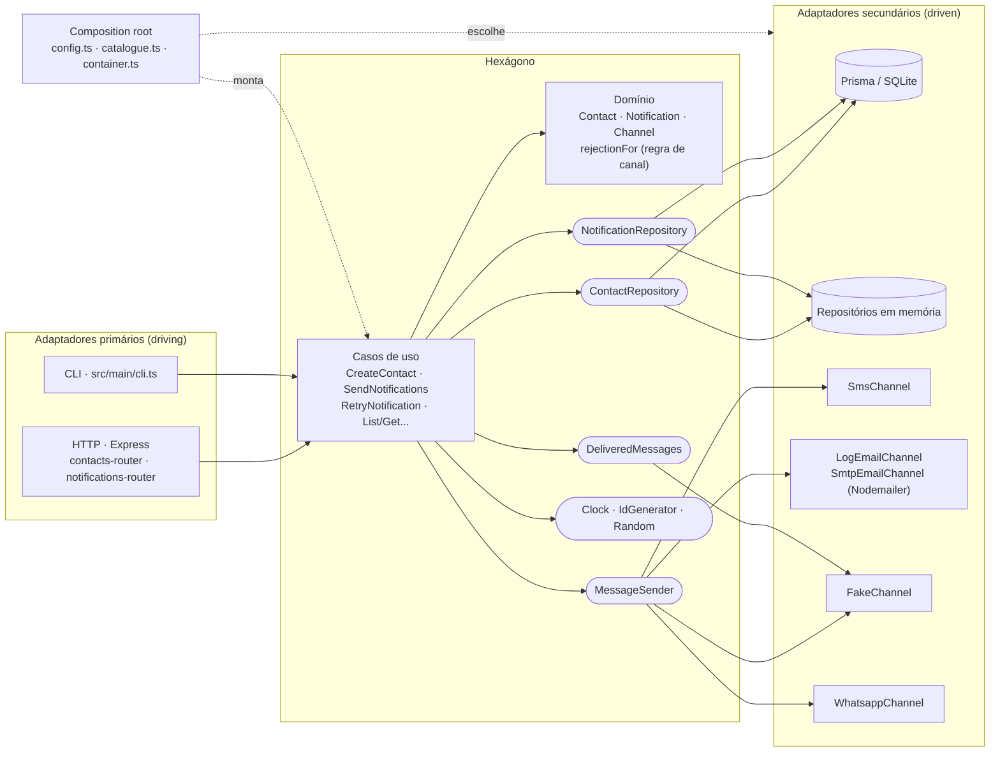

# Aula 07 — Serviço de notificações multicanal

Uma API que envia notificações para contatos por três canais:

| Canal   | O que acontece de verdade                                                     |
| ------- | ----------------------------------------------------------------------------- |
| `fake`  | A mensagem vai para uma caixa de entrada em memória (`GET /fake-inbox/:id`).  |
| `sms`   | Imprime no console e falha aleatoriamente (`SMS_FAILURE_RATE` no `.env`).      |
| `email` | Imprime no console um "e-mail" com remetente, destinatário e assunto.         |

**O código inteiro está em um único arquivo: [`src/index.ts`](src/index.ts).** Configuração, banco de dados, regras de negócio, integração com provedores e rotas HTTP estão todos misturados, de propósito. O sistema funciona — e o trabalho desta aula é transformá-lo em uma arquitetura **Ports and Adapters (hexagonal)** sem mudar o comportamento da API.

O material de conceito é o da aula anterior: [`Aula06/arquitetura-hexagonal.md`](../../Aula06/arquitetura-hexagonal.md). O projeto [`Aula06/project-management`](../../Aula06/project-management/) serve de referência de como um projeto hexagonal fica organizado.

---

## Como rodar

```bash
cd Aula07/notificacoes
cp .env.example .env
npm install
npm run prisma:migrate    # cria o banco SQLite (dev.db)
npm run dev               # http://localhost:3007
```

As requisições de exemplo estão em [`test.http`](test.http) (extensão REST Client do VS Code).

## A API

| Método | Rota                          | Descrição                                                     |
| ------ | ----------------------------- | ------------------------------------------------------------- |
| POST   | `/contacts`                   | Cria contato (`name`, `email?`, `phone?`, `optOut?`)          |
| GET    | `/contacts`                   | Lista contatos                                                |
| GET    | `/contacts/:id`               | Detalhe de um contato                                         |
| POST   | `/notifications`              | Envia (`contactId`, `channels[]`, `message`, `subject?`)      |
| GET    | `/notifications`              | Lista, com filtros `?status=`, `?channel=`, `?contactId=`     |
| GET    | `/notifications/:id`          | Detalhe de uma notificação                                    |
| POST   | `/notifications/:id/retry`    | Reenvia uma notificação que falhou                            |
| GET    | `/fake-inbox/:contactId`      | Mensagens recebidas pelo canal `fake`                         |

---

## Roteiro de refatoração para Ports and Adapters

O roteiro diz **o que** fazer em cada etapa, não **como**. As decisões de nomes, pastas, interfaces e granularidade são de vocês — e devem ser justificáveis. Idealmente a API precisa continuar funcionando em todas etapas.

### Etapa 0 — Entender antes de mexer

- Rodem o sistema e exercitem todas as rotas do `test.http`, inclusive os caminhos de erro.
- Leiam o `src/index.ts` inteiro e marquem cada trecho com a responsabilidade que ele cumpre (configuração, entrada HTTP, validação de formato, regra de negócio, persistência, integração externa…).
- Façam uma lista de **todas as regras de negócio** que vocês encontrarem. Elas estão espalhadas e algumas aparecem mais de uma vez — verifiquem se as cópias são realmente iguais.
- Registrem o comportamento atual (status HTTP e formato das respostas) de cada rota. Esse é o contrato que não pode quebrar.

### Etapa 1 — Rede de segurança

- Antes de mover qualquer código, escrevam testes que exercitem a API por fora (caixa-preta), cobrindo os casos de sucesso e de erro levantados na Etapa 0.
- Encontrem um jeito de tornar o comportamento aleatório e dependente de tempo (falha do SMS, limite por minuto, datas) controlável nos testes. Anotem o que dificultou isso — é um sintoma que a arquitetura deve resolver.

### Etapa 2 — Descobrir o domínio

- Identifiquem os conceitos centrais do negócio e representem-nos em código que **não importa** Express, Prisma nem nenhuma biblioteca de infraestrutura.
- Levem para dentro desses conceitos as regras que pertencem a eles (o que torna um contato válido, quando uma notificação pode ser reenviada, o que cada canal exige…).
- Substituam as strings soltas que representam estados e canais por algo que o compilador consiga verificar.
- Decidam onde vivem as regras que são específicas de um canal e como o domínio fica sabendo delas sem conhecer o provedor.

### Etapa 3 — Casos de uso (portas de entrada)

- Identifiquem as operações que o sistema oferece do ponto de vista de quem o usa, independentemente de HTTP.
- Cada operação vira um caso de uso com entrada e saída próprias, que orquestra o domínio e não sabe de onde veio a requisição.
- Eliminem a duplicação entre "enviar" e "reenviar": a regra deve existir em um só lugar.

### Etapa 4 — Portas de saída

- Listem tudo o que os casos de uso precisam do mundo externo: guardar e buscar dados, entregar mensagens, saber a hora atual, gerar identificadores…
- Para cada necessidade, definam uma porta expressa na linguagem do domínio, não na linguagem da tecnologia que vai implementá-la.
- Reflitam sobre a granularidade: uma porta de envio para todos os canais, ou uma por canal? Qual escolha torna mais fácil adicionar um canal novo?

### Etapa 5 — Adaptadores secundários (driven)

- Implementem as portas de persistência com Prisma. O Prisma Client não pode aparecer fora desses adaptadores.
- Implementem um adaptador para cada canal de envio (fake, SMS, e-mail), preservando o comportamento atual de cada um.
- Criem também implementações em memória das portas de persistência, para uso nos testes.
- Garantam que tipos do Prisma não vazem para o domínio nem para os casos de uso.

### Etapa 6 — Adaptador primário (driving) HTTP

- Reescrevam as rotas Express como um adaptador fino: traduzir a requisição para a entrada do caso de uso, chamá-lo e traduzir a saída (ou o erro) para uma resposta HTTP.
- Separem validação de formato da requisição (responsabilidade do adaptador) das regras de negócio (responsabilidade do domínio).
- Definam como erros do domínio viram status HTTP em um único lugar, e garantam que nenhum erro interno (stack trace, mensagem do Prisma) chegue ao cliente.

### Etapa 7 — Composition root

- Criem um único ponto onde as dependências concretas são instanciadas e conectadas às portas.
- A escolha de implementação (ex.: probabilidade de falha do SMS, banco a usar) deve ser feita ali, a partir da configuração — em nenhum outro lugar se lê `process.env`.
- Verifiquem a direção das dependências: nada dentro do hexágono pode importar algo de fora dele.

### Etapa 8 — Testes em camadas

- Testem o domínio isoladamente, sem banco e sem HTTP.
- Testem os casos de uso usando os adaptadores em memória e dublês das portas de envio.
- Mantenham os testes da Etapa 1 passando sem alteração — eles provam que o contrato da API foi preservado.

### Etapa 9 — Provar que a arquitetura funciona

Cada item abaixo deve ser feito **sem alterar o domínio nem os casos de uso**. Se precisarem alterar, voltem e revejam as fronteiras.

- Adicionem um novo canal (ex.: push ou WhatsApp, também simulado).
- Troquem o provedor de e-mail simulado por um que envie de verdade (ex.: Nodemailer com Ethereal ou Mailtrap), escolhido via configuração.
- Adicionem um segundo adaptador primário (ex.: um CLI que envia uma notificação pela linha de comando) reutilizando os mesmos casos de uso.
- Façam a aplicação subir usando apenas os repositórios em memória, sem Prisma.

---

## Checklist de entrega

- [ ] Todas as rotas respondem com os mesmos status e formatos da versão original.
- [ ] Domínio e casos de uso não importam `express`, `@prisma/client` nem nada de `node_modules` de infraestrutura.
- [ ] Nenhuma regra de negócio está duplicada.
- [ ] Existe um único lugar que instancia e conecta as dependências.
- [ ] Os casos de uso são testáveis sem banco, sem HTTP e sem aleatoriedade.
- [ ] Um canal novo foi adicionado sem tocar no domínio nem nos casos de uso.
- [ ] Um diagrama (pode ser manual/Mermaid) que mostra o hexágono, as portas e os adaptadores do projeto final.
- [x] Um parágrafo no README justifica as principais decisões de granularidade das portas.

---

# Versão refatorada — Ports and Adapters

> A versão original, em um único arquivo, está preservada em [`legacy/index.ts`](legacy/index.ts) para
> comparação. O registro do trabalho está em [`docs/`](docs/): inventário do sistema original (regras,
> duplicações, divergências com evidência), decisões (ADRs), testes por camada, provas da Etapa 9 e
> roteiro da gravação.

## O hexágono, as portas e os adaptadores



## Por que as portas têm essa granularidade

As portas foram separadas por **intenção de negócio**, não por tecnologia: `ContactRepository` e
`NotificationRepository` guardam o que o domínio precisa lembrar; `MessageSender` entrega;
`Clock`/`IdGenerator`/`Random` dizem "que horas são", "que id usar" e "sorteie" (é o que torna o limite por
minuto e a falha do SMS testáveis sem esperar nem reiniciar processo); `DeliveredMessages` lê o que o canal
`fake` recebeu. Para a entrega, a escolha foi **uma porta `MessageSender` + um registro
`canal → adaptador`** montado no composition root, e não uma porta por canal: com uma porta por canal, o
caso de uso precisaria decidir qual chamar, voltando a conhecer os canais concretos — exatamente o
acoplamento que a arquitetura remove. O outro extremo (um adaptador único com `if/else` por canal) faria
todo canal novo editar o adaptador e misturaria regra de transporte com regra de negócio. Já as *regras* de
cada canal (exigir telefone, 160 caracteres, exigir assunto) ficaram no domínio, como descrição de canal:
elas sobrevivem à troca de provedor — um SMS continua tendo 160 caracteres com qualquer operadora. O
resultado é o custo de extensão medido na Etapa 9: canal novo = uma descrição + um adaptador + uma linha no
catálogo, com domínio e casos de uso intocados.

## Como rodar

```bash
npm install
cp .env.example .env
npm run prisma:migrate
npm run dev                 # http://localhost:3007

npm test                    # 50 testes: caixa-preta, domínio, casos de uso e provas de arquitetura
npm run typecheck
npm run build

APP_STORAGE=memory npm run dev        # sobe sem banco (só repositórios em memória)
EMAIL_PROVIDER=smtp npm run dev       # usa o adaptador SMTP real (ver SMTP_*/MAIL_FROM no .env.example)
npm run cli -- send --contact 1 --channels sms,email --subject "Oi" --message "Texto"
```

## Decisões e divergências

| Registro | Assunto |
| --- | --- |
| [`docs/00-inventario.md`](docs/00-inventario.md) | contrato observado, mapa de responsabilidades, R1–R22, duplicações/divergências D1–D9 com evidência |
| [`docs/01-decisoes.md`](docs/01-decisoes.md) | ADR-001 (envio e reenvio usam a mesma regra), ADR-002 (granularidade da porta de envio), ADR-003 (relógio/aleatoriedade/ids como portas), ADR-004 (canal `fake` como adaptador), ADR-005 (limite conta canais pedidos), ADR-006 (erro interno em JSON) |
| [`docs/02-rede-de-seguranca.md`](docs/02-rede-de-seguranca.md) | os testes caixa-preta escritos antes da refatoração |
| [`docs/03-dominio-e-casos-de-uso.md`](docs/03-dominio-e-casos-de-uso.md) | domínio, casos de uso e portas |
| [`docs/04-adaptadores-e-composition-root.md`](docs/04-adaptadores-e-composition-root.md) | adaptadores, HTTP fino e composition root |
| [`docs/05-etapa9.md`](docs/05-etapa9.md) | provas da Etapa 9 (canal novo, SMTP real, CLI, boot em memória) |
| [`docs/06-roteiro-gravacao.md`](docs/06-roteiro-gravacao.md) | roteiro dos 15 minutos, item por item do enunciado |

Mudanças de comportamento, todas intencionais e registradas: o **reenvio** passa a rejeitar SMS com mais
de 160 caracteres e e-mail sem `subject` (ADR-001, era o bug da cópia divergente), e **erro interno** passa
a sair como JSON sem stack trace (ADR-006). Todo o resto — status, formatos, campos, assimetrias de
`optOut`, ordem das listas, mensagens de erro — foi preservado, comprovado pelos 24 testes caixa-preta
escritos antes da refatoração e nunca alterados.

## Checklist de entrega

- [x] Todas as rotas respondem com os mesmos status e formatos da versão original (24 testes caixa-preta, sem alteração).
- [x] Domínio e casos de uso não importam `express`, `@prisma/client` nem infraestrutura.
- [x] Nenhuma regra de negócio duplicada (`rejectionFor` é a única implementação das regras de canal).
- [x] Um único lugar instancia e conecta as dependências (`src/main/container.ts`), e é o único que lê `process.env` (`src/main/config.ts`).
- [x] Casos de uso testáveis sem banco, sem HTTP e sem aleatoriedade/tempo real (relógio, sorteio e ids são portas).
- [x] Canal novo e provedor real adicionados sem tocar em domínio e casos de uso (`docs/05-etapa9.md`).
- [x] Diagrama do hexágono, portas e adaptadores (acima).
- [x] Parágrafo justificando a granularidade das portas (acima).

## Estrutura

```
src/
├── domain/            entidades, value objects e regras (sem framework)
│   └── channels/      descrição de cada canal: as regras que pertencem a ele
├── application/       casos de uso, portas e o serviço de entrega
├── adapters/
│   ├── in/http/       adaptador primário HTTP
│   └── out/           prisma, canais de envio, memória, sistema (relógio/ids/sorteio)
├── main/              composition root: config, catálogo de canais, container, server, CLI
└── index.ts           entrada
legacy/index.ts        arquivo único original, preservado para comparação
tests/
├── e2e/               contrato HTTP (caixa-preta) + provas de arquitetura
├── domain/            regras isoladas
└── application/       casos de uso com dublês
```

